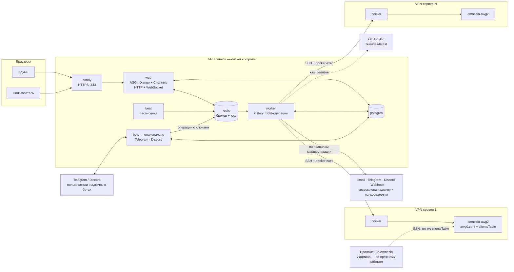
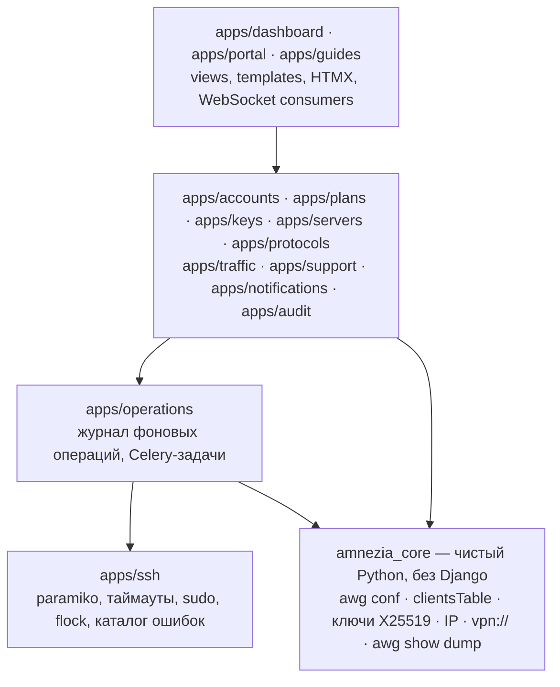
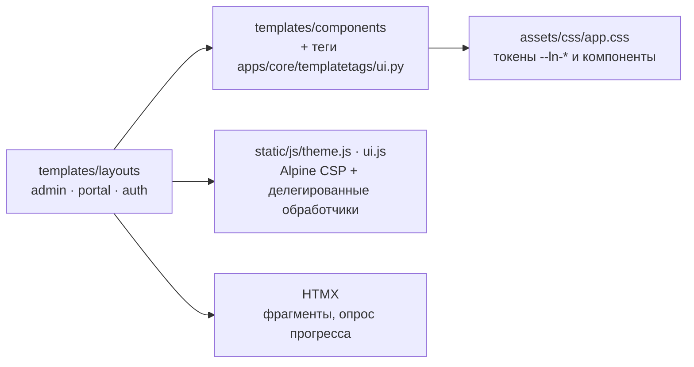
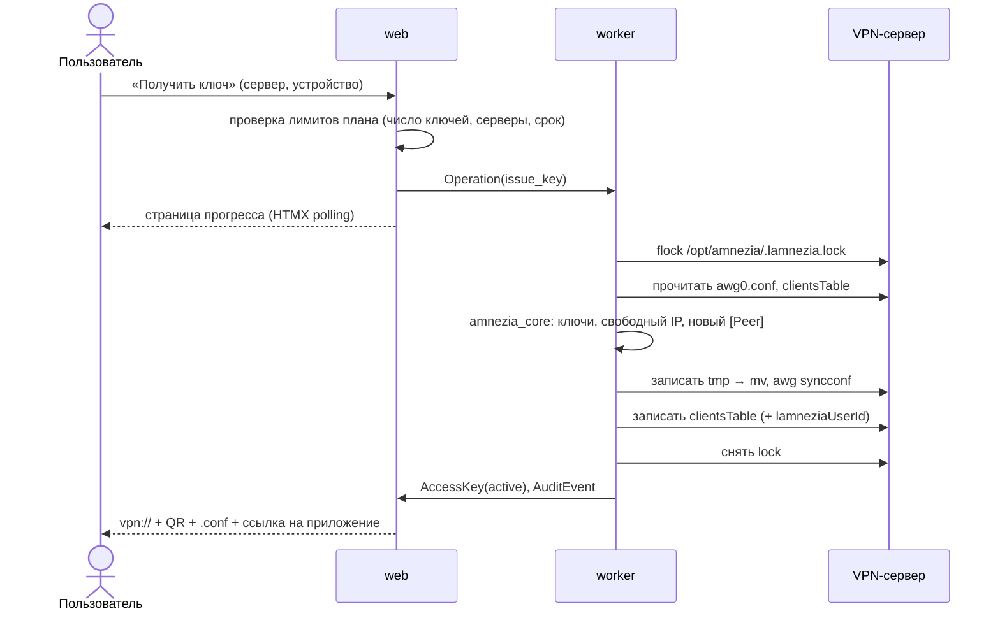
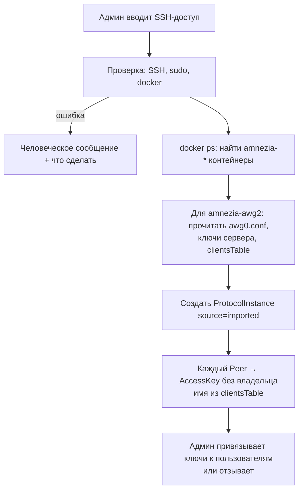
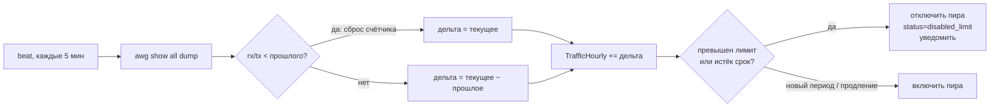
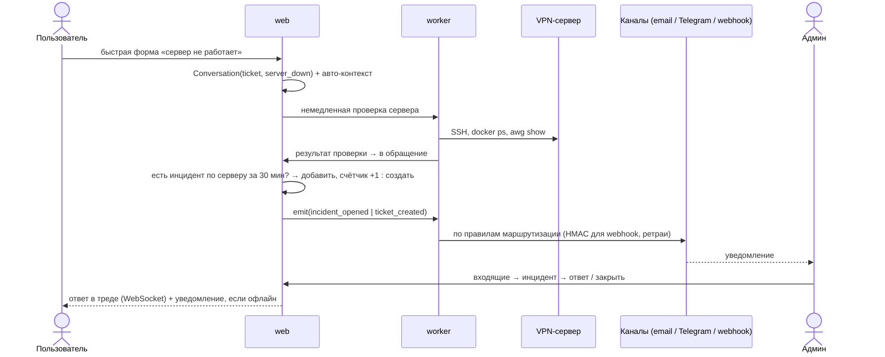
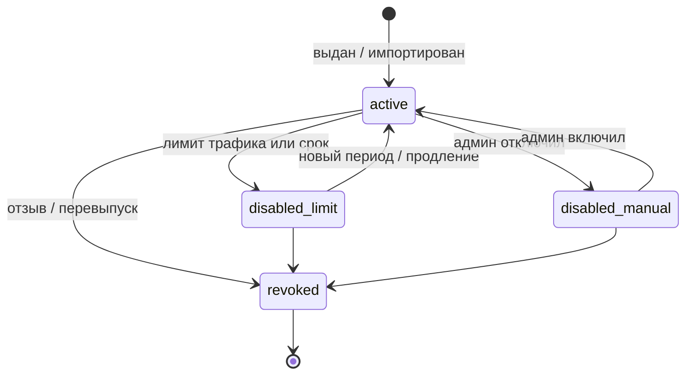

# Архитектура Lamnezia

Схемы в Mermaid — GitHub рендерит их прямо в репозитории. Текстовое описание решений — [DESIGN.md](DESIGN.md).

## 1. Развёртывание

## 2. Слои кода

Правило: `amnezia_core` не импортирует Django и не ходит в сеть. Всё знание о форматах Amnezia — только там.

### Слой интерфейса

Страница — серверный HTML. Состояние на клиенте ограничено Alpine-компонентами из `ui.js`; CSP
`script-src 'self'` без `'unsafe-eval'`. Страницы ошибок — `templates/400|403|404|500.html` и
`templates/errors/` (отказ CSRF — `apps/core/errors.csrf_failure`); они не наследуют каркасы и не
зависят от контекстных процессоров.

## 3. Выдача ключа пользователю

## 4. Импорт существующего сервера

## 5. Учёт трафика и лимиты

## 6. «Сервер не работает» → инцидент → уведомления

## 7. Жизненный цикл ключа

