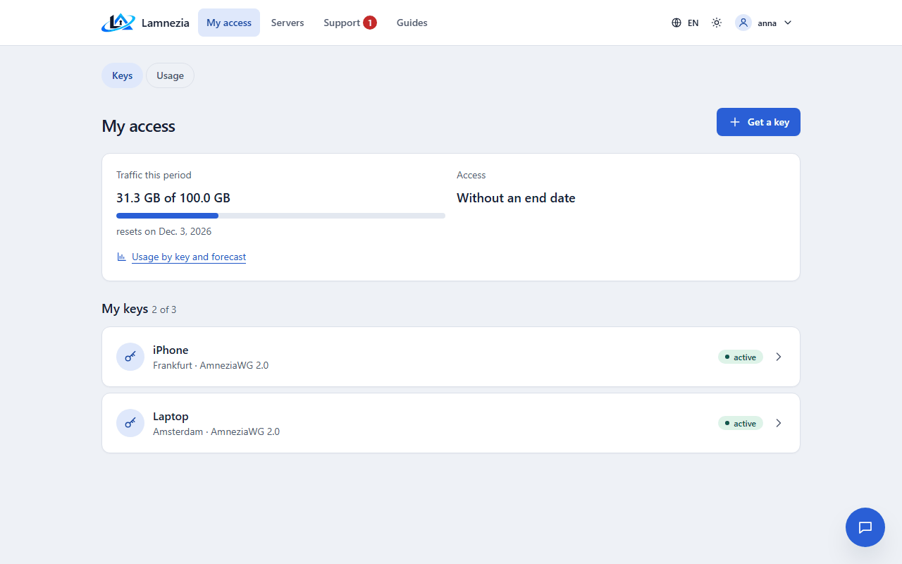
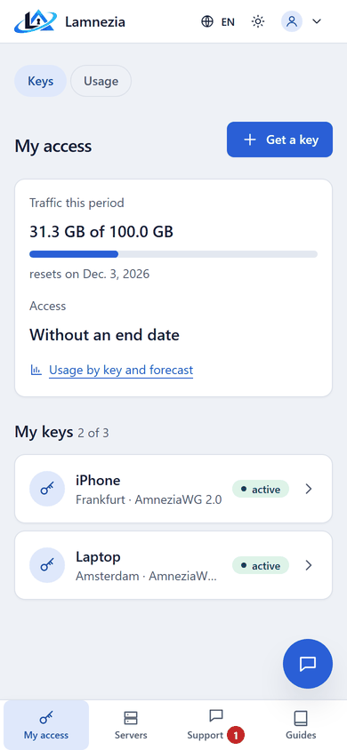
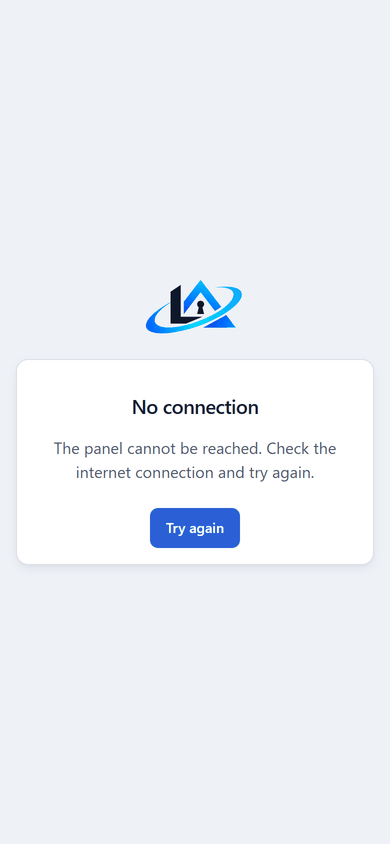

# Client portal

The portal (`/portal/`) is the page a user sees after signing in. It works on a phone as well as
on a computer.

A user waiting for approval sees only a message and the [guides](Guides-and-releases.md). A user without a
plan is asked to get one from an administrator.

## Navigation

The portal tabs — **My access**, **Servers**, **Support**, **Guides** and, with a billing plugin,
**Payment** — are on every portal page, the guides included: in the top bar on a computer and in
the bottom bar on a phone. The guides add their own second row: **Devices**, **FAQ**, **Useful
materials** and **Suggest an article**. A guest reading the guides sees a **Sign in** button
instead, which brings them back to the same page.

The round button at the bottom right of every portal page opens the chat with support over the
page, see [Support requests](Support-and-incidents.md#chat).

Until the user links Telegram or Discord, **My access** and the chat start with an offer to link
one; **Not now** hides it, see [Messengers](Messengers.md#offer-to-link).

Administrators and moderators have a switch in the account menu: **Control panel** from the
portal and **My access** from the control panel. Users do not see it.

## My keys

The page lists the user's keys, how many keys the plan allows, the traffic used in the current
period with the reset date, the total traffic and the access term with the days left. The traffic
bar turns yellow and then red near the limit, and near the end of a limit or of the access term
the page warns about it. Without keys the page offers to get the first one.

## Usage

**Usage by key and forecast** (`/portal/usage/`, the **Usage** tab and a link on **My access**)
shows a chart of traffic uploaded and downloaded for a day, a week or a month and a **By key**
table. A key link narrows the page to that key. A deleted key shows while it has traffic in the
period. With a traffic limit the page says, at the pace since the period began, whether the traffic
lasts until the period resets or when it runs out; with the limit reached, that the keys are off
until the reset.

## Getting a key

**Get a key** is one form:

1. the device — guessed from the browser, chosen with a tap;
2. the server — only the servers and protocols the plan allows, not those under maintenance; with
   one server available it is chosen already and only named;
3. the name — optional, the device name is used if it is empty.

The key is created on the server in the background; its page updates itself until it is ready.
A user cannot get more keys than the plan allows, nor any key after the access term ends.

## Showing a key

**Show the key** gives the `vpn://` link with **Copy** and, on phones, **Share** (the system
share sheet, to send the key to another device), a large QR code, a `.conf` file for AmneziaWG and
a link to the guide for the device. With the "show once" policy (**Settings → Showing a key again**) the key is shown
only once; after that it can only be re-issued. An administrator can allow the owner to open it
again from the key page in **Keys**.

## Subscription link

XRay keys have one lasting link (`/sub/…`) to all of the user's keys. It is added as a
subscription to v2rayN, v2RayTun, Hiddify, Streisand and other XRay clients, and the client keeps
the keys up to date itself: a re-issued key or changed server settings arrive without a new link,
and a disabled key disappears. The **Subscription link** card shows on the portal home page once
the user has an XRay key. There the link is created, replaced with a new one (the old one stops
working at once) and deleted. Whoever knows the link gets the keys, so it is not shared.
The same link is in the bot (`/sub`) and on the user card in **Users**, where an administrator or
the user's moderator creates, replaces or deletes it (the audit journal records it).

Clients that read the `subscription-userinfo` header (v2rayN, Hiddify, Streisand and others) show
the traffic and the access term. Traffic counts both directions of all the user's keys: in the
current period against the period limit, or since the plan was assigned against the total limit,
whichever has less left. Without a traffic limit the client shows it as unlimited, and without an
access end there is no date.

One address may fetch subscription links at most `LAMNEZIA_SUBSCRIPTION_RATE_LIMIT` times a minute
(30 by default); more get `429 Too Many Requests`. Clients refresh every 12 hours, so the limit
only stops someone trying tokens.

The link works only with the "any time" policy: with "show once" there is none. Nor does it work
for a blocked user. The Amnezia app does not read subscriptions: keys are added to it one by one. It updates
configs only for Amnezia's own subscriptions, through a gateway built into the app, which a
self-hosted panel cannot use.

## Other actions

- **Rename** — the new name is also written to `clientsTable`, so the Amnezia app shows it.
- **Re-issue** — the old key is revoked at once and a new one is created on the same server,
  even one under maintenance.
- **Delete** — the key is revoked.

A deleted or re-issued key leaves the list and the limit at once; pressing the button again does
nothing.

## Payment

With a [billing plugin](Billing-plugins.md) turned on, **Payment** lists the plans on sale and the
user's payments. An approved user chooses a plan and a way to pay and is sent to the payment
service. After the payment the order page shows whether it went through, and access is renewed at
once. Without plugins the section is hidden.

## Servers

**Servers** lists the servers the user's plan allows with their state: *working*, *problems* (the
server does not answer, its check failed or an Amnezia container is stopped), *maintenance* (set by
the administrator on the server form) or *no data yet*. The page shows only the name and location:
no address and no host metrics.

A server that does not work for the user is reported with **Does not work** on this page or on
the key page, see [Support requests](Support-and-incidents.md).

## Reachability check

On **My access**, **Get a key** and the key page the user's browser checks by itself whether their
servers answer over UDP, on the servers where the administrator installed the
[reachability probe](Servers-and-import.md#reachability-probe). When a server does not answer within 4 seconds,
a hint appears: "Server … cannot be reached from your network. Try another server or protocol, or
write to support." The hint has a **Does not work** button that sends a support request about
that server in one click. There is one hint per server, however many keys it has.

XRay (Reality) keys are checked over TCP, with no probe needed: the browser opens
`https://<host>:<port>/` with a 4-second limit. A fast answer or a fast error (the Reality
certificate is not for that address) means the port is reachable; silence until the limit means it
is not. The page allows such requests only to those addresses (`connect-src` of its security
policy). Ports browsers never request (22, 25 and the like) and IPv6 addresses are not checked.

- Only servers the user has a key on are probed: the addresses of other servers never reach the
  page. The key page probes only the server of that key.
- The check runs on the user's device. The result stays in the browser: the panel does not receive,
  store or log it.
- With WebRTC turned off in the browser the UDP check has nothing to check with, and no hint is
  shown.

## Install as an app

The panel installs on the home screen and opens in its own window, without the browser bar
(the panel must be served over HTTPS):

- **Android** (Chrome, Edge, Samsung Internet) — the browser menu, **Install app** or **Add to
  Home screen**;
- **iPhone and iPad** (Safari) — **Share**, **Add to Home Screen**;
- **computer** (Chrome, Edge) — the install icon in the address bar.

The app shows the panel's name and logo. When the panel cannot be reached, it shows a
**No connection** page with **Try again** instead of the browser's error. Only that page and
its style are kept on the device: the panel's pages hold keys and personal data and always
come from the server.

| The portal on a phone | No connection |
|---|---|
|  |  |

## Profile

**Profile** (`/accounts/profile/`, the user name in the menu) is one page for users and staff with
these sections:

- **Account** — the user name and email. Changing the email asks for the current password. With
  mail set up, the new address gets a link and the email changes when it is opened while signed in;
  the link lasts as long as a password reset link. Without mail the address changes at once. The
  change goes to the audit log.
- **Password** — a new password signs out every other session.
- **Two-factor** — turning it on, backup codes, turning it off.
- **Messengers** — linking Telegram and Discord, see [Messengers](Messengers.md).
- **Notifications** — where notifications go and in which language.
- **Sessions** — browsers signed in to the account: the browser, the system and the sign-in time
  (no IP address and no page addresses). One of them, or all but the current one, can be signed
  out; this goes to the audit log.

The old addresses `/accounts/security/` and `/accounts/messengers/` lead to their sections.
