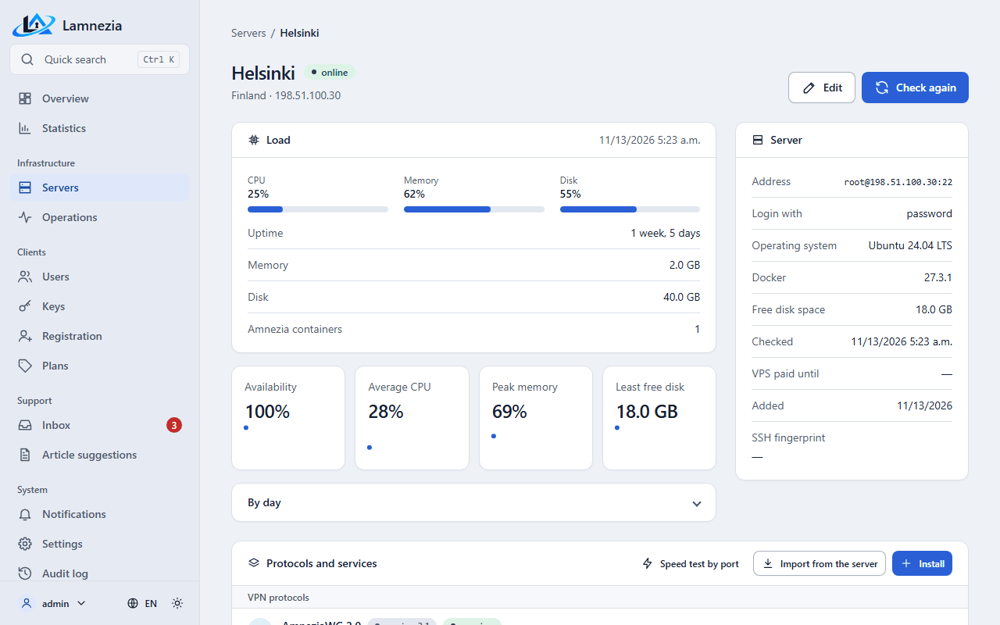

# Servers and import

A server is a VPS that the panel manages over SSH. Servers are visible to administrators only:
**Servers** in the side menu.

## Adding a server

**Servers → Add a server**, then fill in:

- **Name** and **location** (country or any label, e.g. «Germany, Hetzner») — to tell servers apart.
- **Host** — a domain name or an IP address, without `root@`, port or `ssh://`; **SSH port** — 22 by
  default.
- **SSH user** — `root`, or a user with sudo **without a password** (`NOPASSWD` in sudoers), as the
  Amnezia app requires.
- **Login with** — an SSH key (OpenSSH or PEM: Ed25519, ECDSA, RSA; plus the passphrase if the key has
  one) or a password. A key is recommended.
- **VPS paid until** — optional, a reminder about the hosting payment. The server card shows how
  many days are left, or how many days the payment is overdue.
- **Under maintenance** — users see the server as under maintenance on their
  [status page](Portal.md#servers); new keys are not issued on it in the portal, the bots and the
  panel, while existing keys keep working and can be reissued. The server list marks it with a
  *maintenance* badge.

The panel stores the password, key and passphrase encrypted with `LAMNEZIA_ENCRYPTION_KEY` and never
shows them again: when editing a server, leave these fields empty to keep the saved values.

### New address of a server

The `vpn://` link of every key carries the server address. When the **Host** of a server with
keys changes, the panel opens **Keys after the address change**: the keys issued by the panel get
the new address in their profile at once (nothing changes on the server), and the keys imported
from the server, which have no profile in the panel, are reissued if **Reissue the keys imported
from the server** is ticked. The owners get the **Keys must be imported again** notification. **Later** keeps the keys as they are; the change is written to the audit log
(`protocols.readdress`). The reissue is one `keys.reissue` operation per protocol of the server
([Protocols](Protocols.md)).

A new host or SSH port also makes the panel forget the SSH fingerprint saved for the old one; the
audit log keeps it (`servers.forget_host_key`, with the old host and port). The next check trusts
the key of the new address.

**IPsec.** The IPsec server certificate is issued for the server IP, and clients refuse a server
whose IP is not in it. If the server has IPsec, the page warns about it and offers **Reissue the
IPsec server certificate for the new address** (ticked by default). The server card shows the IP
the certificate is issued for, a warning when the server address is another IP, and a **Reissue**
button. The reissue (`protocols.ipsec_reissue`) is a background operation under the server lock:
the same CA signs a certificate for the server IP (resolved if the server is given by a name),
ikev2.conf names it, IPsec restarts and the old certificate is deleted. The CA and the client
certificates stay, so the keys issued by the panel only get the new IP in their profile; the
owners are notified and import the keys again. The keys imported from the server are reissued
only if that box is ticked. A failed operation can be run again: finished steps are not repeated.

## Server check

After the server is added, and after its address or credentials change, the panel checks it in the
background. The check changes nothing on the server:

1. **Connect** over SSH. On the first connection the panel remembers the server host key; if the key
   changes later, the connection is refused (the server was reinstalled or the connection is
   intercepted). The server card shows the saved fingerprint. If the VPS was reinstalled, press
   **Forget** next to it: the panel forgets the fingerprint, writes this to the audit log
   (`servers.forget_host_key`, with the old fingerprint) and checks the server again, trusting
   the key it shows now.
2. **Root access**: the user is root or has passwordless sudo.
3. **Operating system** and kernel.
4. **Docker** version.
5. **Free disk space** in `/var/lib/docker` (or `/` before Docker is installed).

If the connection or root access fails, the server gets the status «check failed», and its page shows
the reason and what to do, e.g. «The server rejected the login. Check the user name and the password or
key». Fix the server settings or the server itself and press **Check again**.

The other findings are only warnings, the server is still «ready»:

- the OS is not Debian or Ubuntu — the panel cannot install protocols there (importing an existing
  server still works);
- Docker is not installed — the panel installs it together with a protocol;
- less than 1 GB is free — a protocol may fail to install.

Every check is recorded in **Operations** with its steps and log.

## Import from a server set up in the Amnezia app

On the server page press **Import from the server**. The panel:

1. lists the running Amnezia containers (`docker ps`, as the Amnezia app does);
2. for **amnezia-awg2** (AmneziaWG 2.0) reads `awg0.conf`, `clientsTable` (both the current and the
   old format) and the preshared key, and saves the protocol with its port, subnet and parameters;
   **amnezia-awg** (AmneziaWG legacy) and **amnezia-wireguard** are read the same way from `wg0.conf`;
   for **amnezia-xray** (VLESS Reality over TCP) it reads `server.json`, `clientsTable` and the
   Reality public key; the client the app made for itself while installing becomes a key too,
   named «Installer's client»; the panel never revokes or disables it, since the app needs it;
   for **amnezia-openvpn** it reads `server.conf`, the certificates in force in `pki/index.txt`,
   `clientsTable` and the CA certificate; the server's own certificate and revoked ones are skipped;
   for **amnezia-ipsec** it reads `ikev2.conf`, the client certificates of the NSS
   database that are not in the revocation list, `clientsTable` and the CA certificate;
   for the proxies it reads the SOCKS5 account from `3proxy.cfg` and the secret of a
   Telegram proxy from `/data/secret` with its mode, domain and public host, as the app;
3. turns every client into a key **without an owner**, named as in the Amnezia app.

The import only reads: it does not change files on the server and does not even take the panel's
server lock, so the Amnezia app keeps seeing the same clients. Imported keys have no private part
(only the client device has it): they cannot be shown or sent again, only given to a user, disabled or
revoked — see [Keys](Keys.md). Imported XRay keys can be shown: the panel builds their profile
from `server.json`.

Other containers (XRay with another transport and so on) are listed as «found, not
supported».
What can be done with an imported protocol: [Protocols](Protocols.md).

Importing again is safe: the protocol settings are refreshed and only clients the panel does not know
yet are added; keys already in the panel, with their names and owners, stay as they are. After the
import keys can be issued on the server, and its traffic is collected.

## Monitoring

Every `LAMNEZIA_MONITOR_INTERVAL` seconds (a minute by default) the `beat` service reads every server
with one SSH command: CPU load, memory, disk space of `/`, time since boot and the state of the Amnezia
containers (`docker ps -a`). The reading changes nothing on the server. Each server is read by a
background job of its own, so a server that does not answer does not delay the others.

- **online** — the server answered within the last two intervals. One missed reading is not an outage
  yet: a server is shown **offline** after two intervals without an answer, together with the reason
  (e.g. «The server did not answer in time») and when it last answered.
- **no data yet** — the server was added and has not been read yet.
- CPU load is measured between two readings, so the first reading after adding a server or after a
  reboot shows «—».
- An Amnezia container that is not running (stopped, exited, restarting) is listed in red. The
  server card shows the state of every protocol and service container from the latest reading
  next to its buttons; a stopped container has **Start** instead of **Restart** and **Stop**.

The servers are shown as cards on the **Overview** (moderators see the servers of their zone, without links to the
server pages), the status is also in the server list. Above the cards the overview shows the key
numbers (servers online, active keys, clients, online now), the traffic for 7 days and the
**Needs attention** list: servers that do not answer, VPS payments due within 7 days or overdue
(administrators only), operations failed in the last day, unread messages, applications and article
suggestions waiting, hidden materials with a broken link. The same counters are next to the menu
items. The crossed-out eye next to an item hides it until tomorrow (for this staff member, in their
session); **Show hidden until tomorrow** under the list brings everything back. Instead of the
servers online a moderator sees **My clients** and **Access ends in 7 days** — their clients whose
access is due for renewal soon. The server page shows the latest reading and the last
7 days: availability (the share of answered readings), average CPU, peak memory and least free disk per
day. Older readings are deleted automatically.

## Reachability probe

A browser cannot send arbitrary UDP, and AmneziaWG ignores packets from strangers, so a browser
cannot probe the AWG port itself. The **Reachability probe** section of the server page solves this:
**Install** puts a small STUN responder (the `lamnezia-probe` container) on a separate UDP port,
3478 by default. Users' browsers ask it over WebRTC and show a hint when the server does not answer
from their network (see [Portal](Portal.md)).

- Port: 1024–65535, not the SSH port and not an Amnezia container port. Open it in the firewall of
  the server and of the hosting provider **before** installing.
- After starting it the panel sends a STUN request to the server itself. Without an answer the
  container is removed and the operation fails with a hint to open the port: otherwise every user
  would see "unreachable".
- The container is unprivileged, read-only and has no logs (`--log-driver none`): the responder
  keeps no record of who asked.
- **Remove** takes down the container and the files in `/opt/lamnezia/probe`. Without the responder
  users' browsers do not probe the server.
- The server monitor watches the container. When a reading finds it stopped, the section warns
  about it and users' browsers stop probing the server until it runs again, so nobody sees a
  false "unreachable". The probe does not count as a stopped VPN container for users.

The probe tells whether UDP reaches the host, not the AWG port itself: if the provider blocks only
the AWG port or detects the protocol by DPI, it still shows "reachable". It also shows "unreachable" when only the probe port is closed
in a cloud firewall, or when the client's network blocks STUN; with WebRTC turned off in the
browser the result is "unknown".

## Server groups

**Servers → Server groups** joins AmneziaWG 3.1 servers into a group whose members are clones of
its leading server: the same server key, settings, port, subnet and clients, so one key works on
each of them. A server is either standalone or a member of one group.

- **New group**: pick a standalone AmneziaWG 3.1 server as the leading one. Nothing changes on it;
  the group takes its port.
- **Join the group**: a standalone AmneziaWG 3.1 server on the same port and subnet takes the files
  of the group in a background operation. If it has its own clients, the panel warns how many keys
  stop working, keeps a snapshot of its files first and revokes those keys, and users who had keys
  on it get keys of the group. A clean server joins without a warning.
- **Leave the group**: the server keeps a snapshot of its files and gets a clean AmneziaWG with a new
  key and no clients.
- The leading server cannot leave; a group with only its leader left can be deleted, and the leader
  stays as it is.

Keys of a group are issued on its leading server. Issuing, disabling, enabling and revoking a key
run on every member that answers, without waiting for the others. A member the panel cannot reach
is marked **lagging**: the relay sends no clients to it. Every `LAMNEZIA_GROUP_CATCH_UP_INTERVAL`
seconds the panel checks the lagging members and, once a server is online again, copies the group
files onto it in the background operation "Catch up with the server group": its keys then match the
group, revoked ones are gone, and it is back in the relay list. If no member answers, the operation
fails and changes nothing.

### Relay

Clients of a group connect to the relay, which forwards their traffic to a live member. Any added
server can be the relay, including the panel's own machine.

1. In the group settings, pick the server in the **Relay** field.
2. On that server's card, open **Relay** and press **Install**. A background operation checks the
   OS, adds the service peer "Lamnezia relay" to every member, builds the `lamnezia-relay`
   container and publishes the ports of the groups as UDP.

The port of a group is checked before the installation: ports 80 and 443 belong to the panel's web
server, and a port another program or container listens on is refused with a clear error. So a
member of the group cannot be on the relay server with the same port. The container runs in its own
network, without `network_mode: host`, and publishes only the ports of the groups.

The agent inside the container probes the members in order every few seconds with a new handshake
through the service peer and sends clients to the first live one. Before a switch the candidate is
probed again, the `nftables` rules change in one transaction, and old connections are dropped. The
agent does not need the panel: switching works even while the panel is down.

When the members, their order, the lagging ones or the port of a group change, the panel updates
the relay by itself every `LAMNEZIA_RELAY_SYNC_INTERVAL` seconds. **Update** on the card does it at
once. **Remove** drops the container and the image; the service peers stay on the members, and
clients of the groups lose the connection until another relay is installed.

Every `LAMNEZIA_RELAY_MONITOR_INTERVAL` seconds the panel reads the state the agent writes. The
group page shows for each member whether the relay reaches it, which one is **active** now and
whether the panel itself reaches it over SSH, with the time of the last switch. The relay card
shows the channel load and where the traffic of each group goes. A switch, a member the relay
cannot reach, a group with no member left, a relay whose state is not read for two intervals and
a member lagging longer than `LAMNEZIA_GROUP_LAG_ALERT` come as notifications
([Notifications](Notifications.md)). Clients of a group are seen by the members at the relay's
address; the panel shows no client addresses.

### Keys of a group behind the relay

Once the relay of a group is installed, the `vpn://` links and `.conf` files of its keys carry the
**Domain** of the group, or the relay address when the domain is empty, and the port of the group.
Keys the leading server had before move to that address in the same operation, and their owners,
like the owners of keys revoked when their server joined, get the notification **Keys updated for
a server group** in the personal account channel: they import the key into the Amnezia app again,
once. A key that keeps the old address goes on working while the leading server is up.

The domain needs only an A record with the relay address. The group page warns when the domain
does not resolve, points elsewhere, or has an AAAA record: the Amnezia app on a computer may take
the IPv6 address and miss the relay.

Traffic, online status and limits of a group key are summed over all members: whichever server the
relay sends the client to, its traffic counts for the same key.

## Server access

The panel connects to servers over SSH as `root` or as a user with passwordless sudo
(`NOPASSWD` in sudoers), like the Amnezia app does. On the first connection the panel remembers the
server host key. If the key changes later, the connection is refused: after reinstalling a server,
delete its record in the Django admin site `/admin/` → **Ssh → Known hosts**.

While the panel changes a server, it holds the lock `/opt/amnezia/.lamnezia.lock`, so two panel
operations never edit one server at the same time. The Amnezia app does not know this lock:
do not edit the same server in the app and in the panel at the same moment.

## Operations

Everything the panel does on servers runs in the background (the `worker` service) and is written
to the operation journal: **Operations** in the admin interface. The page of an operation shows
its steps and their log while it runs. If an operation fails, it shows the failed step, what went
wrong, what to do, and a **Retry** button that runs it again with the same parameters. The name of
the object under the operation title links to its page: the key for a key operation, the server for
the rest (a protocol or a service leads to its server).

The journal can be searched by the object name and filtered by status; the search and the page
stay in the URL, so a filtered list can be shared. While an operation on the page runs, the table
refreshes itself every few seconds.

**Servers** has a search by name, address or location and a status filter. The rows of the list and
the server cards on the dashboard have two quick buttons: **Check again** and **Edit**.

**Ctrl+K** (⌘K on a Mac), or the search button in the menu, opens quick search: type a part of a
server, user or key name and press Enter to open the first result, or walk the results with the
arrows. A moderator finds only their users and keys, and no servers.

Under every list (operations, audit journal, users, keys, notifications, payments) you can choose
how many rows a page shows: 25, 50 or 100. The choice is kept in the session and applies to every
list.

The theme button in the menu opens **Appearance**: light, dark or as the system, and **Page width** —
normal or wide. Every admin page has the same width; the choice is kept in the browser.

If the worker stops in the middle of an operation, the `beat` service marks it as interrupted after
`LAMNEZIA_OPERATION_TIMEOUT` seconds, and it can be retried.
