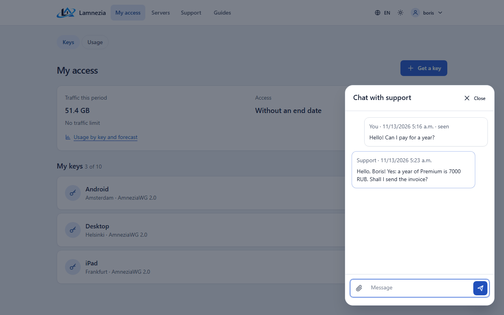
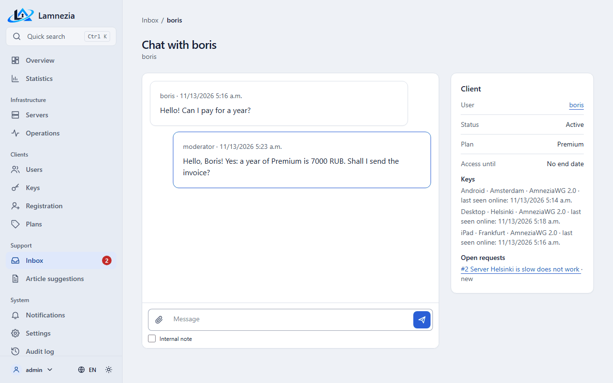

# Support requests

A user writes to the administrators from **Support** in the portal (`/support/`) or in the
chat on any portal page. The **Support** page lists the user's own requests with their state: *new*, *in progress*, *waiting for you*, *resolved* or
*closed*. Nobody else's requests are shown.

## Reporting a problem

**Report a problem** asks what happened (something is broken, a question, other), a description
and an optional screenshot. The panel attaches the user's plan, keys with their last connection and
the browser by itself, so the user need not describe them.

A screenshot is a PNG, JPEG, GIF or WebP image of at most 5 MB; the panel checks the file itself,
not its name. Screenshots are not public: only the owner of the request and the staff can open
them.

## "Server does not work"

The **Does not work** button on the **Servers** page and on a key page opens a request in one
click and starts a check of the server at once. The result is shown on the request and kept with
it: whether the server answers, whether the VPN service runs, when the user's device and anyone
else last connected (for XRay, which has no handshake, the last time a client had traffic). A second click while the request is open adds to the same request.

## The thread

The request page is a thread of messages, as in a messenger: the messages scroll in a box of their
own and the reply field stays under them. The field is one line that grows while typing; Enter
sends and Shift+Enter starts a new line (on a phone the keyboard's button starts a new line and the
arrow sends). The clip attaches a screenshot. A reply is sent without reloading the page. The
thread opens at the latest message and follows new ones down only when it is scrolled to the
bottom, so reading the history is not interrupted. A user's reply to a request *waiting for you* puts it back *in progress*. A closed
request takes no replies — a new one is opened instead. The notes administrators leave for each
other are never shown to the user.

## Chat

The round button at the bottom right of every portal page opens **Chat with support** over
the page: a panel on a computer, the whole screen with **Close** on a phone (it sits above the
bottom tab bar). The button shows how many chat answers are unread; the **Support** tab counts
answers to requests only. Esc or **Close** closes the chat; the page underneath stays as it was.
Opened again on the same page, the chat shows at once with an unsent message kept, fetches only
new messages and stays where it was scrolled; it follows new messages down only from the bottom.
While closed, it marks nothing as read.
The old address `/support/chat/` (and the links in reminders) opens the portal with the chat open.

| Chat on the portal | The same chat in the inbox |
|---|---|
|  |  |

It is the one shared chat of a user with the administrators; it shows up in **Inbox → Chats** with
the user's first message. Every message of the user sends the **Chat message** event, see
[Notifications](Notifications.md).

The chat also tells about the requests: a line such as "Request #12: support answered" or
"… closed" appears when the staff answer a request or set it *waiting for you*, *resolved* or
*closed*. The line is a link to the request and carries no text of the answer; it counts as read
at once, so an answer is counted once — on the **Support** tab.

## Live updates

The chat, the requests and the inbox update by themselves: a new message reaches the other side in
a fraction of a second, *seen* shows under one's own messages, and the unread counters in the
portal and admin menus change without a reload. The page keeps a WebSocket at `/ws/support/` (the
proxy must pass WebSocket through — the Caddy of `compose.yaml` and the nginx example do). The
socket only says "something changed"; the page then fetches the messages with an ordinary request
that checks permissions, so nobody can follow someone else's conversation. Without WebSocket the
page polls the panel every 15 seconds and reconnects by itself. While the tab is hidden, messages
are not marked as seen. When the staff close a request, its reply form disappears from an open page
at once.

An answer of the staff goes where the user last wrote from: to the site, or from the bot to a
messenger. When the user neither answers nor reads it within 2 minutes, the panel reminds them
with one message and a link, where they chose to get notifications (or another channel when that
one does not work), unless the answer itself reached that channel, see
[Notifications](Notifications.md).

## Limits and notifications

A user opens at most `LAMNEZIA_SUPPORT_RATE_LIMIT` requests an hour (5 by default) and sends at
most `LAMNEZIA_SUPPORT_MESSAGE_RATE_LIMIT` messages a minute (10 by default; 0 — no limit), see
[Configuration](Configuration.md). Every new request sends the **New support request** event,
see [Notifications](Notifications.md).

## Inbox

The staff work with requests in **Admin → Inbox** (`/support/inbox/`). The menu shows how many
messages from users are unread. **Requests** lists the requests and **Chats** the support chats;
both are filtered by plan, server and text (user name, email or any message) and sorted by unread
first, last message, newest or oldest. Requests are also filtered by type, status, assignee and
date. A chat in the list shows its last message (with "Support:" before an answer of the staff)
and **Waiting** when the user wrote last; such chats come first by default. The list updates by
itself when a user writes or another staff member answers.

An administrator sees every conversation and assigns it to an administrator or to the user's
moderator. A moderator sees only the conversations of their users that are assigned to them or to
nobody ([moderator's zone](Security.md)); they reply, leave notes and change the
status there.

On a request page the staff see the plan, keys, browser and the server check, reply to the user or
leave an **internal note** — notes are marked in the thread and never shown to the user. A reply to
a *new* request takes it *in progress*. **Reply templates** fill the answer field with a ready text;
an administrator adds, edits and deletes them in **Inbox → Reply templates**. The template list and
the **Internal note** box sit in a small line under the reply field.

Beside a chat the staff see the **Client** card: the user's status, plan and access end date, keys
with the time each was last seen online, open requests with links, and for an administrator a link
to the user's page.

## Incidents

Reports that the same server does not work are grouped into an **incident**: a report joins the
open incident of that server if the previous report came within
`LAMNEZIA_SUPPORT_INCIDENT_WINDOW_MINUTES` (30 by default), otherwise a new incident is opened and
the **Incident opened** event is sent. Ten reports about one server are one incident with a counter
of ten. While an incident is open, the server is shown with *problems* on the portal status page.

An administrator closes an incident on **Admin → Inbox → Incidents**, optionally with a message.
The message is posted to every open report of the incident, the reports are closed, everyone who
reported gets an email that the server works again, and the **Incident closed** event is sent.
