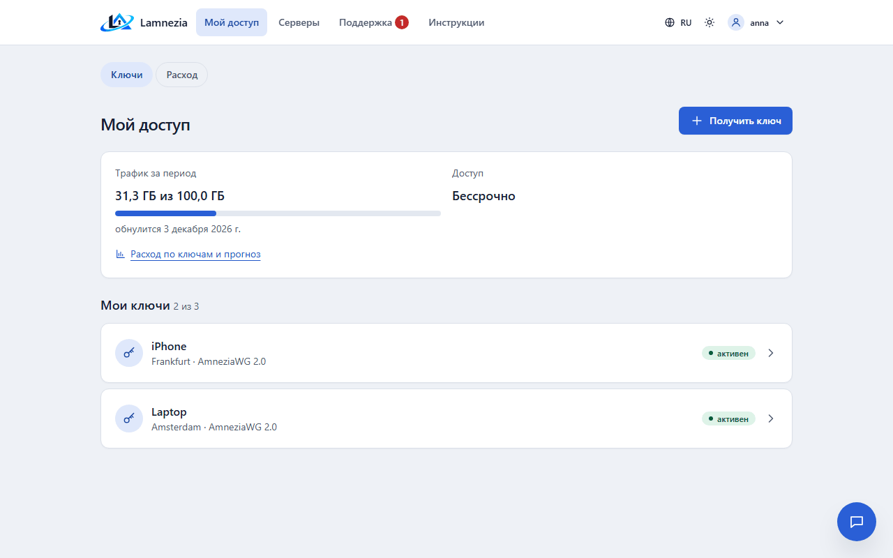
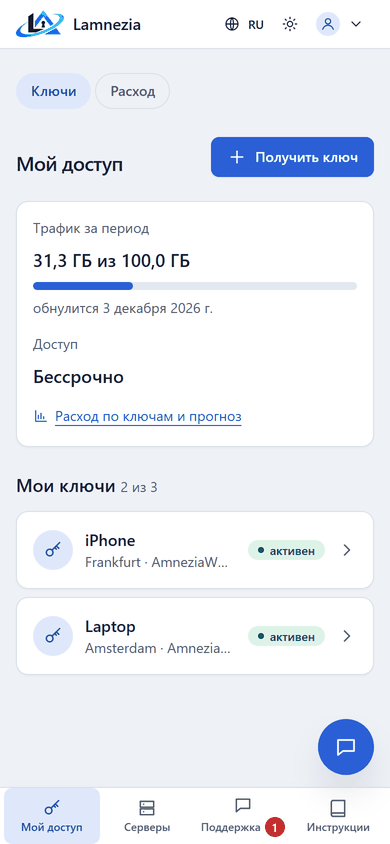
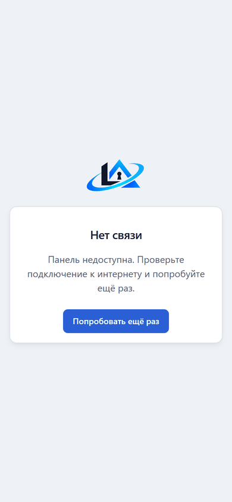

# Клиентский портал

Портал (`/portal/`) — страница, которую пользователь видит после входа. Он работает и на телефоне,
и на компьютере.

Пользователь, ожидающий подтверждения, видит только сообщение и [инструкции](Guides-and-releases.md).
Пользователю без тарифа предлагается попросить его у администратора.

## Навигация

Вкладки портала — **Мой доступ**, **Серверы**, **Поддержка**, **Инструкции** и, с плагином оплаты,
**Оплата** — есть на каждой странице портала, в том числе в инструкциях: на компьютере в верхней
панели, на телефоне в нижней. У инструкций свой второй ряд вкладок: **Устройства**, **FAQ**,
**Полезные материалы** и **Предложить статью**. Гость, читающий инструкции, видит вместо вкладок
кнопку **Войти**, которая после входа возвращает на ту же страницу.

Круглая кнопка в правом нижнем углу каждой страницы портала открывает чат с поддержкой поверх
страницы, см. [Обращения](Support-and-incidents.md#чат).

Пока пользователь не привязал Telegram или Discord, **Мой доступ** и чат начинаются с
предложения привязать; **Не сейчас** его скрывает, см. [Мессенджеры](Messengers.md#предложение-привязать).

У администраторов и модераторов в меню аккаунта есть переключатель: **Панель управления** из
портала и **Мой доступ** из панели. Пользователи его не видят.

## Мои ключи

На странице — ключи пользователя, сколько ключей разрешает тариф, трафик за текущий период с датой
обнуления, трафик всего и срок доступа с числом оставшихся дней. Полоса трафика у лимита
становится жёлтой, затем красной, а когда лимит или срок подходят к концу, страница
предупреждает об этом. Если ключей нет, страница предлагает получить первый.

## Расход

**Расход по ключам и прогноз** (`/portal/usage/`, вкладка **Расход** и ссылка на **Моём доступе**)
показывает график отправленного и скачанного за сутки, неделю или месяц и таблицу **По ключам**.
Нажатие на ключ сужает страницу до него. Удалённый ключ виден, пока у него есть трафик за период.
При лимите трафика страница по темпу с начала периода говорит, хватит ли трафика до сброса периода
или когда он кончится; когда лимит исчерпан — что ключи отключены до сброса.

## Получение ключа

**Получить ключ** — одна форма:

1. устройство — определяется по браузеру, выбирается касанием;
2. сервер — только серверы и протоколы, разрешённые тарифом, кроме серверов на обслуживании; если
   доступен один сервер, он уже выбран и только назван;
3. название — необязательно, если пусто, берётся название устройства.

Ключ создаётся на сервере в фоне, его страница обновляется сама, пока он не будет готов.
Нельзя получить больше ключей, чем разрешает тариф, и нельзя получить ключ после окончания доступа.

## Показ ключа

**Показать ключ** — ссылка `vpn://` с кнопками **Скопировать** и, на телефонах, **Поделиться**
(системное меню «Поделиться», чтобы отправить ключ на другое устройство), крупный QR-код, файл
`.conf` для AmneziaWG и ссылка на инструкцию для устройства. При политике «показать один раз» (**Настройки → Повторный показ ключа**) ключ
показывается только один раз, дальше его можно только перевыпустить. Администратор может
разрешить владельцу открыть ключ ещё раз на странице ключа в разделе **Ключи**.

## Ссылка-подписка

Для ключей XRay есть одна постоянная ссылка (`/sub/…`) на все ключи пользователя. Её добавляют
как подписку в v2rayN, v2RayTun, Hiddify, Streisand и другие клиенты XRay, и клиент сам
обновляет ключи: перевыпущенный ключ или изменённые настройки сервера приходят без новой
ссылки, отключённый ключ пропадает. Карточка **Ссылка-подписка** появляется на главной портала,
когда у пользователя есть ключ XRay. Там ссылку создают, заменяют новой (старая сразу перестаёт
работать) и удаляют. Кто знает ссылку, тот получает ключи, поэтому ею не делятся.
Та же ссылка есть в боте (`/sub`) и на карточке пользователя в разделе **Пользователи**: там её
создаёт, заменяет или удаляет администратор или модератор пользователя (действие попадает в
журнал аудита).

Клиенты, которые читают заголовок `subscription-userinfo` (v2rayN, Hiddify, Streisand и другие),
показывают трафик и срок доступа. Трафик — оба направления всех ключей пользователя: за текущий
период против лимита на период или с назначения тарифа против общего лимита — где осталось
меньше. Без лимита трафика клиент покажет его безлимитным, без конца доступа — без даты.

С одного адреса ссылки-подписки можно запрашивать не чаще `LAMNEZIA_SUBSCRIPTION_RATE_LIMIT` раз в
минуту (по умолчанию 30), сверх этого — ответ `429 Too Many Requests`. Клиенты обновляют подписку
раз в 12 часов, так что ограничение мешает только перебору токенов.

Ссылка работает только при политике «показывать в любое время»: при политике «показать один
раз» её нет. Не работает она и у заблокированного пользователя. Приложение Amnezia подписок не
читает, в него ключи добавляют по одному. Обновляет конфиги оно только для подписок самой
Amnezia — через встроенный в приложение шлюз, которым панель на своём сервере воспользоваться не может.

## Другие действия

- **Переименовать** — новое название записывается и в `clientsTable`, его видно в приложении
  Amnezia.
- **Перевыпустить** — старый ключ сразу отзывается, на том же сервере создаётся новый, даже если
  сервер на обслуживании.
- **Удалить** — ключ отзывается.

Удалённый или перевыпущенный ключ сразу пропадает из списка и не занимает место в лимите; повторное
нажатие ничего не делает.

## Оплата

Если включён [плагин оплаты](Billing-plugins.md), раздел **Оплата** показывает тарифы в продаже и
платежи пользователя. Одобренный пользователь выбирает тариф и способ оплаты и переходит в платёжный
сервис. После оплаты страница заказа показывает, прошла ли она, а доступ продлевается сразу. Без
плагинов раздел скрыт.

## Серверы

**Серверы** — серверы, разрешённые тарифом пользователя, и их состояние: *работает*, *проблемы*
(сервер не отвечает, его проверка не прошла или остановлен контейнер Amnezia), *обслуживание*
(ставит администратор в форме сервера) или *нет данных*. На странице только название и
расположение: ни адреса, ни метрик хоста.

Если сервер не работает, кнопка **Не работает** на этой странице или на странице ключа сообщает
об этом администраторам, см. [Обращения](Support-and-incidents.md).

## Проверка доступности

На страницах **Мой доступ**, **Получить ключ** и на странице ключа браузер пользователя сам проверяет,
отвечают ли его серверы по UDP, — на тех серверах, где администратор установил
[проверку доступности](Servers-and-import.md#проверка-доступности). Если сервер не ответил за 4 секунды, появляется
подсказка: «Сервер … недоступен из вашей сети. Попробуйте другой сервер или протокол или напишите
в поддержку». В подсказке есть кнопка **Не работает**: она одним нажатием отправляет обращение в
поддержку об этом сервере. На один сервер — одна подсказка, сколько бы ключей на нём ни было.

Ключи XRay (Reality) проверяются по TCP, без пробника: браузер открывает `https://<хост>:<порт>/`
с пределом 4 секунды. Быстрый ответ или быстрая ошибка (сертификат Reality не для этого адреса)
значит, что порт доступен; тишина до предела — недоступен. Страница разрешает такие запросы только
к этим адресам (`connect-src` её политики безопасности). Порты, к которым браузеры не обращаются
(22, 25 и подобные), и адреса IPv6 не проверяются.

- Проверяются только серверы, на которых у пользователя есть ключ: адреса других серверов в
  страницу не попадают. На странице ключа — только сервер этого ключа.
- Проверка идёт с устройства пользователя. Результат остаётся в браузере: панель его не получает,
  не хранит и не пишет в журнал.
- Если в браузере выключен WebRTC, проверке по UDP нечем проверять, и подсказки не будет.

## Установка как приложение

Панель ставится на главный экран и открывается в своём окне, без строки браузера (панель
должна работать по HTTPS):

- **Android** (Chrome, Edge, Samsung Internet) — меню браузера, **Установить приложение** или
  **Добавить на главный экран**;
- **iPhone и iPad** (Safari) — **Поделиться**, **На экран «Домой»**;
- **компьютер** (Chrome, Edge) — значок установки в адресной строке.

У приложения название и логотип панели. Когда панель недоступна, вместо ошибки браузера
открывается страница **Нет связи** с кнопкой **Попробовать ещё раз**. На устройстве хранится
только эта страница и её оформление: страницы панели содержат ключи и личные данные и всегда
загружаются с сервера.

| Портал на телефоне | Нет соединения |
|---|---|
|  |  |

## Профиль

**Профиль** (`/accounts/profile/`, имя пользователя в меню) — одна страница для пользователей и
сотрудников с разделами:

- **Аккаунт** — имя и почта. Смена почты требует текущий пароль. Если почта настроена, на новый
  адрес приходит ссылка, и почта меняется, когда её открыть, войдя в аккаунт; ссылка действует
  столько же, сколько ссылка сброса пароля. Без почты адрес меняется сразу. Смена пишется в журнал.
- **Пароль** — при смене пароля все остальные сеансы завершаются.
- **Двухфакторная** — включение, резервные коды, отключение.
- **Мессенджеры** — привязка Telegram и Discord, см. [Мессенджеры](Messengers.md).
- **Уведомления** — куда приходят уведомления и на каком языке.
- **Сеансы** — браузеры, в которых выполнен вход: браузер, система и время входа (без IP и адресов
  страниц). Можно выйти в одном из них или на всех, кроме текущего; это пишется в журнал.

Старые адреса `/accounts/security/` и `/accounts/messengers/` ведут в нужный раздел.
