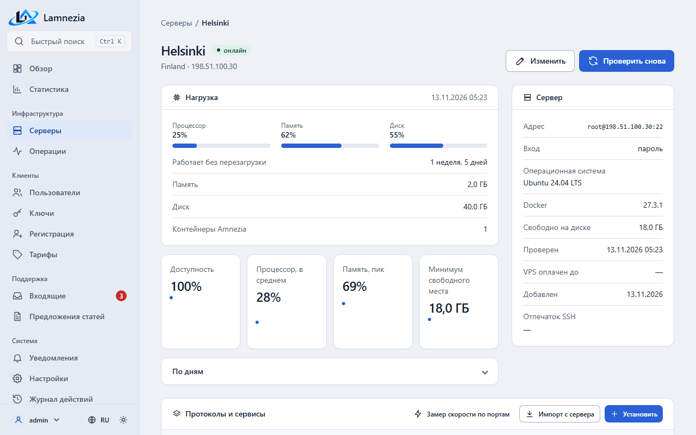

# Серверы и импорт

Сервер — это VPS, которым панель управляет по SSH. Серверы видны только администраторам:
**Серверы** в боковом меню.

## Добавление сервера

**Серверы → Добавить сервер**, затем заполните:

- **Название** и **расположение** (страна или любая метка, например «Германия, Hetzner») — чтобы
  различать серверы.
- **Хост** — доменное имя или IP-адрес, без `root@`, порта и `ssh://`; **порт SSH** — по умолчанию 22.
- **Пользователь SSH** — `root` или пользователь с sudo **без пароля** (`NOPASSWD` в sudoers), как
  требует приложение Amnezia.
- **Вход** — SSH-ключ (OpenSSH или PEM: Ed25519, ECDSA, RSA; и пароль ключа, если он есть) или пароль.
  Рекомендуется ключ.
- **VPS оплачен до** — необязательно, напоминание об оплате хостинга. На карточке сервера видно,
  сколько дней осталось или на сколько дней оплата просрочена.
- **На обслуживании** — пользователи увидят на [странице статуса](Portal.md#серверы), что сервер на
  обслуживании; новые ключи на нём не выдаются ни в портале, ни в ботах, ни в панели, а выданные
  работают и перевыпускаются. В списке серверов у него метка *обслуживание*.

Пароль, ключ и пароль ключа хранятся зашифрованными ключом `LAMNEZIA_ENCRYPTION_KEY` и больше не
показываются: при изменении сервера оставьте эти поля пустыми, чтобы сохранить прежние значения.

### Новый адрес сервера

Адрес сервера входит в ссылку `vpn://` каждого ключа. Когда у сервера с ключами меняется **Хост**,
панель открывает страницу **Ключи после смены адреса**: ключи, выданные панелью, сразу получают
новый адрес в профиле (на сервере ничего не меняется), а ключи, импортированные с сервера, у
которых в панели нет профиля, перевыдаются, если отмечено **Перевыпустить ключи, импортированные
с сервера**. Владельцы получают уведомление **Ключи нужно импортировать заново**.
**Позже** оставляет ключи как есть; смена пишется в журнал действий (`protocols.readdress`).
Перевыдача — одна операция `keys.reissue` на протокол сервера ([Протоколы](Protocols.md)).

При смене хоста или SSH-порта панель также забывает отпечаток SSH, сохранённый для старого
адреса; он остаётся в журнале действий (`servers.forget_host_key`, со старыми хостом и портом).
Следующая проверка доверится ключу нового адреса.

**IPsec.** Сертификат сервера IPsec выпущен для IP сервера, и клиенты не подключаются к серверу,
чьего IP в нём нет. Если на сервере есть IPsec, страница предупреждает об этом и предлагает
**Перевыпустить сертификат сервера IPsec для нового адреса** (отмечено по умолчанию). Карточка
сервера показывает IP, для которого выпущен сертификат, предупреждение, если адрес сервера —
другой IP, и кнопку **Перевыпустить**. Перевыпуск (`protocols.ipsec_reissue`) — фоновая операция
под блокировкой сервера: тот же CA подписывает сертификат для IP сервера (если сервер задан
именем, оно разрешается), ikev2.conf указывает на него, IPsec перезапускается, старый сертификат
удаляется. CA и сертификаты клиентов остаются, поэтому ключи, выданные панелью, только получают
новый IP в профиле; владельцы получают уведомление и импортируют ключи заново. Ключи,
импортированные с сервера, перевыдаются, только если отмечен этот флажок. Упавшую операцию можно
запустить снова: выполненные шаги не повторяются.

## Проверка сервера

После добавления сервера и после смены его адреса или учётных данных панель проверяет его в фоне.
Проверка ничего не меняет на сервере:

1. **Подключение** по SSH. При первом подключении панель запоминает ключ хоста; если ключ потом
   изменится, подключение будет отклонено (сервер переустановлен или соединение перехвачено).
   Сохранённый отпечаток виден на карточке сервера. Если VPS переустановили, нажмите рядом с ним
   **Забыть**: панель забудет отпечаток, запишет это в журнал действий
   (`servers.forget_host_key`, со старым отпечатком) и заново проверит сервер, доверившись
   ключу, который он показывает сейчас.
2. **Права root**: пользователь — root или у него есть sudo без пароля.
3. **Операционная система** и ядро.
4. Версия **Docker**.
5. **Свободное место** в `/var/lib/docker` (или в `/`, пока Docker не установлен).

Если не удалось подключиться или нет прав root, сервер получает статус «проверка не прошла», а на его
странице написаны причина и что делать, например «Сервер отклонил вход. Проверьте имя пользователя и
пароль или ключ». Исправьте настройки сервера или сам сервер и нажмите **Проверить снова**.

Остальное — только предупреждения, сервер остаётся «готов»:

- ОС не Debian и не Ubuntu — панель не сможет установить там протоколы (импорт существующего сервера
  работает);
- Docker не установлен — панель установит его вместе с протоколом;
- свободно меньше 1 ГБ — протокол может не установиться.

Каждая проверка записывается в **Операции** с шагами и журналом.

## Импорт сервера, настроенного в приложении Amnezia

На странице сервера нажмите **Импорт с сервера**. Панель:

1. находит запущенные контейнеры Amnezia (`docker ps`, как приложение Amnezia);
2. для **amnezia-awg2** (AmneziaWG 2.0) читает `awg0.conf`, `clientsTable` (в текущем и старом
   формате) и общий ключ (PSK) и сохраняет протокол с портом, подсетью и параметрами;
   **amnezia-awg** (старый AmneziaWG) и **amnezia-wireguard** читаются так же, из `wg0.conf`;
   у **amnezia-xray** (VLESS Reality поверх TCP) читаются `server.json`, `clientsTable` и
   публичный ключ Reality; клиент, которого приложение создало для себя при установке, тоже становится
   ключом «Клиент установщика»; панель не отзывает и не отключает его — он нужен приложению;
   у **amnezia-openvpn** читаются `server.conf`, действующие сертификаты из `pki/index.txt`,
   `clientsTable` и сертификат CA; собственный сертификат сервера и отозванные пропускаются;
   у **amnezia-ipsec** читаются `ikev2.conf`, сертификаты клиентов из NSS-базы, которых нет
   в списке отзыва, `clientsTable` и сертификат CA;
   у прокси читаются учётная запись SOCKS5 из `3proxy.cfg` и секрет прокси для Telegram
   из `/data/secret` с его режимом, доменом и публичным адресом, как в приложении;
3. превращает каждого клиента в ключ **без владельца** с именем из приложения Amnezia.

Импорт только читает: он не меняет файлы на сервере и даже не берёт серверную блокировку панели, так
что приложение Amnezia видит тех же клиентов. У импортированных ключей нет приватной части (она есть
только на устройстве клиента): их нельзя показать или отправить заново, только отдать пользователю,
отключить или отозвать — см. [Ключи](Keys.md). Импортированные ключи XRay показать можно: панель
собирает их профиль из `server.json`.

Остальные контейнеры (XRay с другим транспортом и другие) показываются как «найден, не
поддерживается». Что можно сделать с импортированным протоколом — [Протоколы](Protocols.md).

Повторный импорт безопасен: параметры протокола обновляются, добавляются только клиенты, которых панель
ещё не знает; ключи, уже бывшие в панели, с их именами и владельцами не меняются. После импорта на
сервере можно выдавать ключи, и по нему собирается трафик.

## Мониторинг

Каждые `LAMNEZIA_MONITOR_INTERVAL` секунд (по умолчанию минуту) сервис `beat` опрашивает каждый сервер
одной SSH-командой: загрузка процессора, память, место на диске `/`, время с загрузки и состояние
контейнеров Amnezia (`docker ps -a`). Опрос ничего не меняет на сервере. Каждый сервер опрашивается
отдельной фоновой задачей, поэтому недоступный сервер не задерживает замеры остальных.

- **онлайн** — сервер ответил за последние два интервала. Один пропущенный замер ещё не авария: сервер
  показывается **офлайн** после двух интервалов без ответа, вместе с причиной (например, «Сервер не ответил
  вовремя») и временем последнего ответа.
- **нет данных** — сервер добавлен и ещё не опрашивался.
- Загрузка процессора считается между двумя замерами, поэтому в первом замере после добавления сервера или
  перезагрузки — «—».
- Контейнер Amnezia, который не запущен (остановлен, завершился, перезапускается), выделяется красным.
  На карточке сервера состояние каждого контейнера протокола и сервиса из последнего замера видно
  рядом с его кнопками; у остановленного вместо **Перезапустить** и **Остановить** — **Запустить**.

Серверы показаны карточками на **Обзоре** (модераторы видят серверы своей зоны, без ссылок на
страницы серверов), статус — ещё и в списке серверов. Над карточками обзор показывает ключевые
цифры (серверов онлайн, активных ключей, клиентов, онлайн сейчас), трафик за 7 дней и список
**Требует внимания**: серверы, которые не отвечают, оплата VPS в ближайшие 7 дней или просроченная
(только администраторам), операции с ошибкой за сутки, непрочитанные сообщения, ждущие заявки и
предложения статей, скрытые материалы с битой ссылкой. Те же счётчики — рядом с пунктами меню.
Кнопка с перечёркнутым глазом у пункта списка прячет его до завтра (для этого сотрудника, в его
сессии); **Показать скрытое до завтра** под списком возвращает всё. Модератор вместо серверов
онлайн видит **Мои клиенты** и **Доступ кончается за 7 дней** — своих клиентов, которым скоро
продлевать доступ. На странице сервера — последний замер и последние 7 дней:
доступность (доля замеров с ответом), средняя загрузка процессора, пик памяти и минимум свободного места
по дням. Более старые замеры удаляются автоматически.

## Проверка доступности

Браузер не умеет слать произвольный UDP, а AmneziaWG молчит на чужие пакеты, поэтому проверить
порт AWG из браузера нельзя. Для этого на странице сервера есть раздел **Проверка доступности**:
кнопка **Установить** ставит на сервер маленький STUN-ответчик (контейнер `lamnezia-probe`) на
отдельный UDP-порт, по умолчанию 3478. Браузеры пользователей спрашивают его через WebRTC и
показывают подсказку, если сервер из их сети не отвечает (см. [Портал](Portal.md)).

- Порт: 1024–65535, не порт SSH и не порт контейнера Amnezia. Откройте его в брандмауэре сервера
  и хостинга **до** установки.
- После запуска панель сама шлёт STUN-запрос на сервер. Нет ответа — контейнер удаляется, операция
  завершается ошибкой с подсказкой открыть порт: иначе всем пользователям показывалось бы
  «недоступен».
- Контейнер без привилегий, только для чтения, без журналов (`--log-driver none`): ответчик не
  записывает, кто к нему обращался.
- **Удалить** — снимает контейнер и файлы в `/opt/lamnezia/probe`. Пока ответчика нет, проверка у
  пользователей не идёт.
- Монитор серверов следит за контейнером. Если замер нашёл его остановленным, раздел предупреждает
  об этом, а браузеры пользователей перестают проверять сервер, пока ответчик не заработает, —
  чтобы никому не показывалось ложное «недоступен». Для пользователей остановленный пробник не
  считается остановленным контейнером VPN.

Проверка смотрит, доходит ли UDP до хоста, а не конкретный порт AWG: если провайдер режет только
порт AWG или узнаёт протокол по DPI, она покажет «доступен». И наоборот, «недоступен» будет, если в облачном брандмауэре закрыт
только порт ответчика или сеть клиента режет STUN; с выключенным в браузере WebRTC результат —
«неизвестно».

## Группы серверов

**Серверы → Группы серверов** объединяют серверы AmneziaWG 3.1 в группу, участники которой —
клоны ведущего сервера: тот же ключ сервера, настройки, порт, подсеть и клиенты, поэтому один
ключ работает на каждом из них. Сервер либо одиночный, либо участник одной группы.

- **Новая группа**: выберите одиночный сервер AmneziaWG 3.1 ведущим. На нём ничего не меняется,
  группа берёт его порт.
- **Вступить в группу**: одиночный сервер AmneziaWG 3.1 на том же порту и в той же подсети получает
  файлы группы в фоновой операции. Если у него есть свои клиенты, панель предупреждает, сколько
  ключей перестанет работать, сначала сохраняет снимок его файлов и отзывает эти ключи, а
  пользователям, у которых были ключи на нём, выдаёт ключи группы. Чистый сервер вступает без
  предупреждения.
- **Выйти из группы**: сохраняется снимок файлов сервера, и он получает чистый AmneziaWG с новым
  ключом и без клиентов.
- Ведущий сервер выйти не может; группу, в которой остался только ведущий, можно удалить — ведущий
  остаётся как есть.

Ключи группы выдаются на её ведущем сервере. Выдача, отключение, включение и отзыв ключа
выполняются на всех участниках, которые отвечают, не дожидаясь остальных. Участник, до которого
панель не достучалась, помечается как **отстающий**: ретранслятор не направляет на него клиентов.
Раз в `LAMNEZIA_GROUP_CATCH_UP_INTERVAL` секунд панель проверяет отстающих и, когда сервер снова
в сети, копирует на него файлы группы фоновой операцией «Догон группы серверов» — после этого
ключи на нём совпадают с группой, отозванные удалены, и он возвращается в список ретранслятора.
Если не отвечает ни один участник, операция завершается ошибкой и ничего не меняет.

## Доступ к серверам

Панель подключается к серверам по SSH под `root` или под пользователем с sudo без пароля
(`NOPASSWD` в sudoers) — так же, как приложение Amnezia. При первом подключении панель запоминает
ключ сервера. Если ключ потом изменится, подключение будет отклонено: после переустановки сервера
удалите его запись в Django-админке `/admin/` → **Ssh → Known hosts**.

Пока панель изменяет сервер, она держит блокировку `/opt/amnezia/.lamnezia.lock`, поэтому две
операции панели не правят один сервер одновременно. Приложение Amnezia эту блокировку не знает:
не правьте один сервер одновременно в приложении и в панели.

## Операции

Всё, что панель делает на серверах, выполняется в фоне (сервис `worker`) и записывается в журнал
операций: **Операции** в интерфейсе администратора. Пока операция идёт, на её странице видны шаги
и их лог. Если операция упала, там же видно, на каком шаге, что случилось и что сделать, и есть
кнопка **Повторить** — она запускает операцию заново с теми же параметрами. Название объекта под
заголовком операции ведёт на его страницу: ключа — для операции с ключом, сервера — для остальных
(протокол и сервис ведут на свой сервер).

Журнал можно искать по названию объекта и фильтровать по статусу; поиск и страница остаются в URL,
так что отфильтрованным списком можно поделиться. Пока на странице есть идущая операция, таблица
сама обновляется каждые несколько секунд.

В разделе **Серверы** есть поиск по имени, адресу или расположению и фильтр по статусу. У строк
списка и у карточек серверов на главной — две быстрые кнопки: **Проверить снова** и **Изменить**.

**Ctrl+K** (⌘K на Mac) или кнопка поиска в меню открывает быстрый поиск: наберите часть имени
сервера, пользователя или ключа и нажмите Enter, чтобы открыть первый результат, или пройдите по
результатам стрелками. Модератор находит только своих пользователей и ключи, серверы — нет.

Под каждым списком (операции, журнал действий, пользователи, ключи, уведомления, платежи) можно
выбрать, сколько строк показывать на странице: 25, 50 или 100. Выбор запоминается в сессии и
действует на все списки.

Кнопка темы в меню открывает **Оформление**: светлая, тёмная или как в системе, и **Ширина
страницы** — обычная или широкая. Все страницы админки одной ширины; выбор хранится в браузере.

Если worker остановился посреди операции, сервис `beat` через `LAMNEZIA_OPERATION_TIMEOUT` секунд
пометит её прерванной, и её можно будет повторить.
