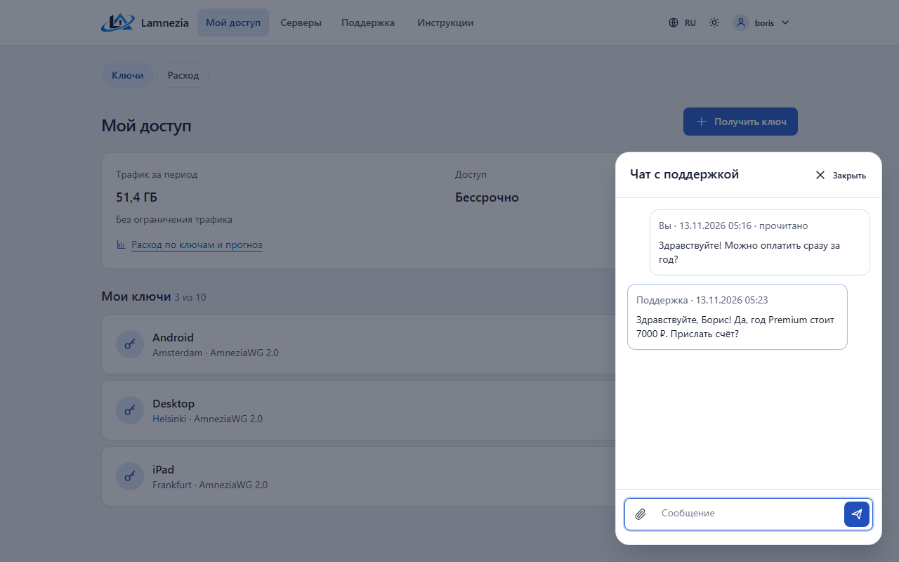
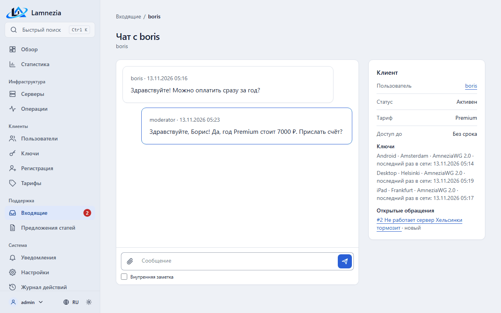

# Обращения

Пользователь пишет администраторам из раздела **Поддержка** портала (`/support/`) или в чат на
любой странице портала. На странице **Поддержка** — его собственные обращения и их состояние: *новое*, *в работе*, *ждёт вашего ответа*, *решено* или
*закрыто*. Чужие обращения не видны.

## Сообщить о проблеме

**Сообщить о проблеме** спрашивает, что случилось (что-то сломалось, вопрос, другое), описание и
по желанию скриншот. Тариф, ключи с последним подключением и браузер панель прикладывает сама —
описывать их не нужно.

Скриншот — изображение PNG, JPEG, GIF или WebP до 5 МБ; панель проверяет сам файл, а не его имя.
Скриншоты не публичны: открыть их могут только автор обращения и администраторы.

## «Не работает сервер»

Кнопка **Не работает** на странице **Серверы** и на странице ключа открывает обращение в один
клик и сразу запускает проверку сервера. Результат виден в обращении и хранится вместе с ним:
отвечает ли сервер, работает ли VPN-сервис, когда последний раз подключалось устройство
пользователя и кто-либо ещё (для XRay, у которого нет рукопожатия, — когда у клиента последний раз был
трафик). Повторное нажатие, пока обращение открыто, дополняет его же.

## Переписка

Страница обращения — переписка, как в мессенджере: сообщения прокручиваются в своём окне, а поле
ответа всегда под ними. Поле — одна строка, которая растёт по мере набора; Enter отправляет,
Shift+Enter — новая строка (на телефоне кнопка клавиатуры переносит строку, а отправляет стрелка).
Скрепка прикрепляет скриншот. Ответ уходит без перезагрузки страницы. Переписка открывается на
последнем сообщении и опускается за новыми, только если прокручена до конца, — чтение истории не
прерывается. Ответ пользователя на обращение *ждёт вашего ответа* возвращает его *в работу*.
В закрытое обращение ответить нельзя — открывается новое. Внутренние заметки администраторов
пользователю никогда не показываются.

## Чат

Круглая кнопка в правом нижнем углу каждой страницы портала открывает **Чат с поддержкой**
поверх страницы: панелью на компьютере, на весь экран с кнопкой **Закрыть** на телефоне (там она
стоит над нижней панелью вкладок). На кнопке — число непрочитанных ответов в чате; вкладка
**Поддержка** считает только ответы на обращения. Esc или **Закрыть** закрывают чат, страница под
ним не меняется. Открытый снова на той же странице, чат появляется сразу, с недописанным
сообщением, догружает только новые сообщения и остаётся там, куда его прокрутили; к новым
сообщениям он прокручивается сам, только если был внизу. Закрытый чат ничего не отмечает
прочитанным. Старый адрес `/support/chat/` (и ссылки в напоминаниях) открывает портал с
открытым чатом.

| Чат в портале | Тот же чат во входящих |
|---|---|
|  |  |

Это один общий чат пользователя с администраторами; он появляется во **Входящих → Чаты** с первым
сообщением пользователя. Каждое сообщение пользователя отправляет событие **Сообщение в чате**,
см. [Уведомления](Notifications.md).

Чат рассказывает и об обращениях: строка вроде «Обращение №12: ответ поддержки» или «… закрыто»
появляется, когда поддержка отвечает в обращении или ставит ему статус *ждёт вашего ответа*,
*решено* или *закрыто*. Строка — ссылка на обращение, текста ответа в ней нет; она сразу считается
прочитанной, так что ответ учитывается один раз — на вкладке **Поддержка**.

## В реальном времени

Чат, обращения и входящие обновляются сами: новое сообщение появляется у собеседника за доли
секунды, под своими сообщениями видно *прочитано*, счётчик непрочитанного в меню портала и
админки меняется без перезагрузки. Страница держит WebSocket `/ws/support/` (прокси должен
пропускать WebSocket — Caddy из `compose.yaml` и пример nginx это делают). По сокету приходит только
сигнал «что-то изменилось», сами сообщения страница забирает обычным запросом с проверкой прав:
подписаться на чужой разговор нельзя. Если WebSocket недоступен, страница опрашивает панель раз в
15 секунд и переподключается сама. Пока вкладка скрыта, сообщения не отмечаются прочитанными.
Когда сотрудник закрывает обращение, форма ответа сразу пропадает с открытой страницы.

Ответ поддержки приходит туда, откуда пользователь писал последним: на сайт или от бота в
мессенджер. Если за 2 минуты пользователь не ответил и не прочитал ответ, панель напоминает о нём
одним сообщением со ссылкой туда, что он выбрал для уведомлений (а если там недоступно — в
другой канал), если сам ответ туда ещё не дошёл, см. [Уведомления](Notifications.md).

## Ограничения и уведомления

Пользователь открывает не больше `LAMNEZIA_SUPPORT_RATE_LIMIT` обращений в час (по умолчанию 5)
и отправляет не больше `LAMNEZIA_SUPPORT_MESSAGE_RATE_LIMIT` сообщений в минуту (по умолчанию 10;
0 — без ограничения), см. [Настройка](Configuration.md). Каждое новое обращение отправляет событие
**Новое обращение в поддержку**, см. [Уведомления](Notifications.md).

## Входящие

Сотрудники работают с обращениями в **Админка → Входящие** (`/support/inbox/`). В меню видно,
сколько сообщений пользователей не прочитано. **Обращения** — список обращений, **Чаты** — чаты
поддержки; оба фильтруются по тарифу, серверу и тексту (имя, email или любое сообщение) и
сортируются: сначала непрочитанные, по последнему сообщению, новые или старые. Обращения
фильтруются ещё по типу, статусу, исполнителю и дате. В списке чатов видно последнее сообщение
(перед ответом сотрудника — «Поддержка:») и отметка **Ждёт ответа**, если последним написал
пользователь; такие чаты по умолчанию выше. Список обновляется сам, когда пользователь пишет или
отвечает другой сотрудник.

Администратор видит все разговоры и назначает исполнителя — администратора или модератора
пользователя. Модератор видит только разговоры своих пользователей, назначенные ему или никому
([зона модератора](Security.md)): отвечает в них, оставляет заметки и меняет статус.

На странице обращения видны тариф, ключи, браузер и проверка сервера; сотрудник отвечает
пользователю или оставляет **внутреннюю заметку** — заметки выделены в переписке и пользователю не
показываются. Ответ на *новое* обращение переводит его *в работу*. **Шаблоны ответов** подставляют
готовый текст в поле ответа; администратор добавляет, правит и удаляет их в разделе
**Входящие → Шаблоны ответов**. Выбор шаблона и флажок **Внутренняя заметка** — в небольшой строке
под полем ответа.

Рядом с чатом — карточка **Клиент**: статус пользователя, тариф и дата конца доступа, ключи со
временем, когда каждый был в сети, открытые обращения со ссылками, а для администратора — ссылка на
страницу пользователя.

## Инциденты

Сообщения о том, что не работает один и тот же сервер, собираются в **инцидент**: сообщение
присоединяется к открытому инциденту сервера, если предыдущее пришло не раньше чем
`LAMNEZIA_SUPPORT_INCIDENT_WINDOW_MINUTES` назад (по умолчанию 30 минут), иначе открывается новый
инцидент и отправляется событие **Открыт инцидент**. Десять сообщений об одном сервере — один
инцидент со счётчиком 10. Пока инцидент открыт, на странице статуса портала у сервера — *проблемы*.

Администратор закрывает инцидент в **Админка → Входящие → Инциденты**, по желанию с сообщением.
Сообщение попадает во все открытые обращения инцидента, обращения закрываются, все сообщившие
получают письмо, что сервер снова работает, и отправляется событие **Инцидент закрыт**.
